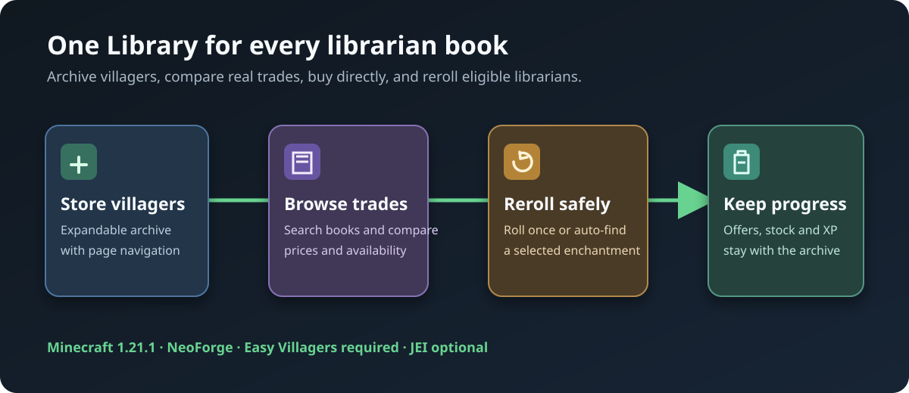

# Easy Villager Enchantment Archive

A searchable enchanted-book archive and reroll workstation for [Easy Villagers](https://github.com/henkelmax/easy-villagers).

Stop comparing librarian trades one villager at a time. Store captured villagers in one block, browse the best book offers together, buy directly from the Library, and reroll fresh librarians without constantly placing and breaking a workstation.



## What it does

- **Store villagers** — Put Easy Villager items into the expandable archive. It supports paging instead of a fixed villager cap.
- **Find books quickly** — Search a combined list of highest-level enchanted-book offers. Filter by price quality or available stock.
- **Compare prices clearly** — See original price, current discounted price, and the vanilla range the offer could have rolled.
- **Buy from one screen** — Select an offer and use normal payment and result slots. The source villager remains visible and is highlighted in the archive.
- **Reroll safely** — Load a fresh Librarian in the built-in workstation. **Roll** makes one new set of offers; **Auto-roll** keeps searching for a selected enchantment. Exact names such as `Protection IV` are preferred over similarly named enchantments.
- **Keep progress** — Offers, stock, villager experience and the archive survive closing the screen and breaking the Library block.
- **Work with JEI** — The Enchantment Archive has JEI aliases and tells JEI where its expandable panels are.

## Requirements

| Required | Version tested |
| --- | --- |
| Minecraft | 1.21.1 |
| Java | 21 |
| NeoForge | 21.1.251 |
| [Easy Villagers](https://modrinth.com/mod/easy-villagers) | 1.21.1-1.1.42 |

[JEI](https://modrinth.com/mod/jei) 19.57.0.446 is optional but recommended for recipe lookup and searching. Install the Archive on both the client and server. It is a NeoForge mod, not a client-only or Fabric mod.

## Getting started

1. Install Easy Villagers and this mod, then restart Minecraft.
2. Craft the **Enchantment Library** with four emerald blocks, four bookshelves and an Easy Villagers Auto Trader. JEI shows the recipe when installed.
3. Open the Library, expand the villager panel, and insert captured villagers.
4. Search or filter the trade list, select a book, then pay in the normal trade slots.
5. Open the circular-arrow panel to reroll an eligible fresh Librarian. Press **Roll** for one new offer set, or search for a book and use **Auto-roll**.

Fresh means an adult Librarian with no earned villager XP. A villager that has been traded with is deliberately protected from rerolling.

## Building from source

The repository contains a Gradle wrapper and resolves its dependencies from public repositories. It does not bundle Easy Villagers, JEI, Minecraft, worlds, logs, or launcher files.

```sh
./gradlew build
```

On Windows, run `gradlew.bat build`. The release JAR is written to `build/libs/`.

Integration tests run in a dedicated local world and are excluded from the release JAR. Read the [Minecraft EULA](https://aka.ms/MinecraftEULA); if you agree, create `run-integration/eula.txt` containing `eula=true`, then run:

```sh
./gradlew runIntegrationServer
```

## Compatibility and credits

This is an independent add-on. It is not an official Easy Villagers release and is not endorsed by its author. Easy Villagers remains a required dependency with its own rights. See [third-party notices](THIRD_PARTY_NOTICES.md) and the [changelog](CHANGELOG.md).

The internal mod ID remains `easy_villagers_enchantment_library` so worlds that already contain the Library continue to work.

## Support

Please include Minecraft, NeoForge, Easy Villagers and Archive versions, clear reproduction steps, and a relevant log or screenshot when opening an issue.
